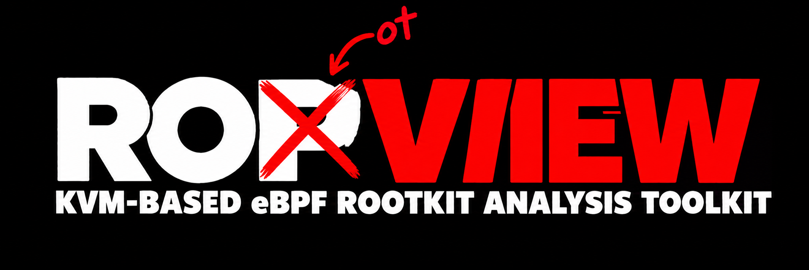

# RootView - KVM-based eBPF Linux Rootkit Detection Toolkit 

haur haur haur haur haur haur haur

### What is this johnson?

This project uses KVM introspection tooling to introspect on VMs "from outside looking in". With that we have easy to use functions for viewing guest registers, pmem/vmem,  attaching VM-Exit hooks, and retrieving kernel objects through our `rvprim (rootview primitives)` abstraction. With that we also wrap this all up in another python library for neat helper tools under `rvtools`.  

The main niceness of the project is that it is all wrapped into a neat python library (through C bindings) where you can develop any researchware for malware analysis. 

Also as the subtitle suggests, one of the cool things is that we have tooling on introspecting and analyzing eBPF programs!!

#### Python lib

`./setup-python.sh` builds `librootview.so` and installs `rootview` into `.venv`. Then `. .venv/bin/activate`.

Refer to the `docs/`

#### Web server

Our senior design professor forced us to make a web GUI to showcase the tool.

`./run-web.sh` builds the lib and serves on http://127.0.0.1:8000 (`ROOTVIEW_PORT` to change it).

#### CLI Usage

You will need to install an `iso` file in order to introspect into that `iso's` VM. 
 - `./rv vm [args]` - will set up your VM. Here is a default one I like: `./rv vm create test --cdrom [iso path] --display gtk`

### Init
You need to set up bare-metal KVM-VMI, we have a VM with it all set up in `RELEASES`. But if you need to do it yourself for your machine, [just follow this guide](https://kvm-vmi.github.io/kvm-vmi/kvmi-v7/setup.html)

#### Docker building
Build inside docker image built in `build/Dockerfile`. This docker container should setup LibVMI for you.

build docker container: `docker build build -t rootview`

run docker container: `docker run --rm -it -v $(pwd):/root/env rootview /bin/bash`

inside docker container run `make all`

Afterwards, just run the tool outside the docker container.

